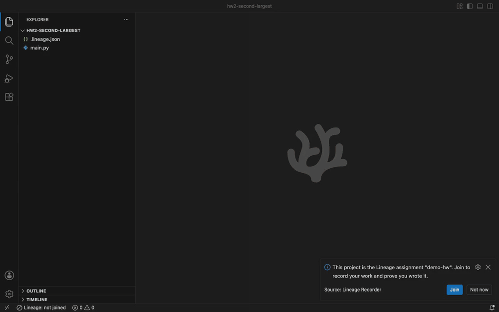
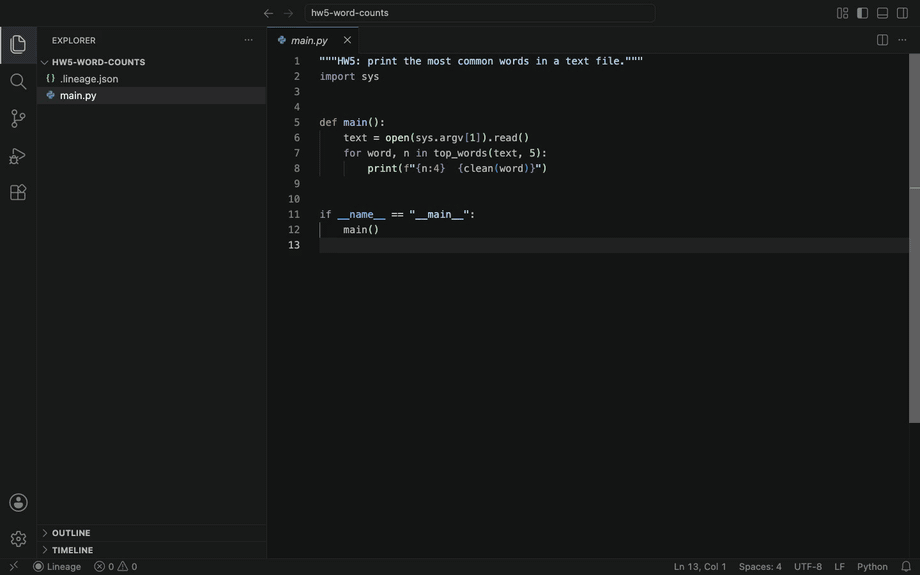
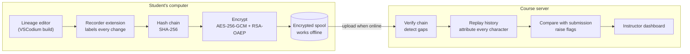

<div align="center">


# Lineage

### Show how the code got written.

**Lineage is a code editor for computer science courses. It keeps track of where each line of an assignment came from: typed by the student, pasted in, or written by an AI agent. Students who did their own work can show it, and instructors can see which parts came from somewhere else.**

[](LICENSE)
[](https://github.com/VSCodium/vscodium)
[](https://nodejs.org)
[](#roadmap)

[**▶ Live demo**](https://lineage-demo.pages.dev) · [Run it locally](#try-it) · [How it works](#how-it-works) · [What it catches](#what-it-catches) · [Privacy](#privacy)

<br />



<sub>Recorded in the Lineage app. A student joins, types part of a solution, pastes a snippet from outside, runs <b>Claude Code</b> in the terminal, and submits. Then the instructor opens that same session: typed code in green, the paste in orange, the agent's code in red, and a marker for when the agent ran. Sped up 1.6× · <a href="lineage/docs/demo.mp4">▶ full-speed video</a></sub>

</div>

---

## The problem

An AI agent can finish a typical CS assignment in a couple of minutes. The usual ways of dealing with that all have problems:

| Approach | Problem |
|---|---|
| **Plagiarism checkers** (MOSS and similar) | They compare students with each other. Code an AI wrote for one student won't match anyone. |
| **AI text detectors** | They guess from the finished code, and they flag real students by mistake. |
| **Webcam proctoring** | Invasive, unpopular, and no use for take-home projects. |
| **Banning AI in the syllabus** | Hard to enforce, and students who followed the rules have no way to show it. |

Lineage takes a different approach. It records the assignment while it's being written, so the history is there to look at afterwards.

## What Lineage does

<table>
<tr>
<td width="33%" valign="top">

### Labels every change
Each edit is tagged the moment it happens: **typed**, **pasted from inside the editor**, **pasted from outside**, **written to disk by another program**, or **not recorded** (changed while Lineage was closed, or before the student joined).

</td>
<td width="33%" valign="top">

### Keeps the record private
Events are linked in a **SHA-256 hash chain** and **encrypted on the student's computer** so only the course server can open them. Students can't read or edit their own recording, and if part of it goes missing the instructor is told.

</td>
<td width="33%" valign="top">

### Shows the instructor what happened
The server replays the history, rebuilds every file character by character, and reports **how much was written in Lineage**, along with specific flags like "this file was written by another program." The instructor decides what to make of it.

</td>
</tr>
</table>

<div align="center">

<sub>A student who used an agent: 2.1% written in Lineage. The pink band is when Codex CLI was running in the terminal, and red is code written to disk by another program.</sub>
</div>

## The instructor dashboard

You start from your courses, open an assignment, work through the students who need a look, and dig into the details for each one.

<div align="center">

<sub>Replaying a student's history. A bit of typing (green), then an agent started in the terminal writes three files at once (red).</sub>
</div>

<table>
<tr>
<td width="50%"></td>
<td width="50%"></td>
</tr>
<tr>
<td><b>Courses.</b> Each assignment shows how many students are waiting for review.</td>
<td><b>Review queue.</b> Starts with just the flagged students and says why each one is there. Mark each one <i>Clear</i> or <i>Follow up</i> and the list gets shorter.</td>
</tr>
</table>

On each student's page:

- **Two timelines.** The top one covers the whole history (often thousands of events) and marks every paste and agent write. Drag it to move quickly; the zoomed one underneath is for going step by step.
- **Frame-by-frame replay** with `←` `→`, or press play to watch it at the student's pace.
- **The whole project's file tree**, with each file colored by where its code came from. Starter files nobody touched are dimmed.
- **A code view with a minimap** that marks where in the file the outside code sits.
- **Clickable flags** that jump to the moment they happened, plus private notes for each student.
- **`[` and `]`** to move to the previous or next student without going back to the list.

<div align="center">

<sub>A student who did their own work: 100% written in Lineage over three sessions and six days, no flags. If anyone ever questions their work, this is their answer.</sub>
</div>

## Citing outside code

Plenty of courses now allow ChatGPT or Stack Overflow as long as students cite what they used. Lineage helps with that part. After a paste from outside the project, a small notification in the corner asks where it came from. The student pastes a link (a ChatGPT or Claude share link, a Stack Overflow question, a GitHub file) or just picks the tool, and Lineage:

- adds an IEEE reference to `REFERENCES.md`, reusing the number if the same source was cited before
- puts a comment above the pasted code, like `# Source: [1] OpenAI, "ChatGPT," Accessed: Nov. 12, 2026. [Online]. Available: https://chatgpt.com/share/…`
- tells the instructor which pastes were cited and which weren't

<div align="center">

<sub>Recorded in the Lineage app. A student pastes a helper, cites it with a ChatGPT link, and gets the comment and the <code>REFERENCES.md</code> entry. Then the instructor's view: the paste counted as cited, the source listed, and the cited code in blue. Sped up 1.3× · <a href="lineage/docs/cite.mp4">▶ full-speed video</a></sub>
</div>

Typed code can be cited too, with **Lineage: Cite Selection**. Links are recognized from the URL itself, so nothing gets fetched. On the dashboard, cited pastes show up in blue and are listed under **Sources cited**. A student whose outside code is all cited stays out of the review queue. Instructors can turn the prompt off with `"citations": { "prompt": false }` in `.lineage.json`.

The source is whatever the student says it is, so a student could name the wrong one. The pasted text is still in the replay if you want to check.

## How it works



1. The instructor creates the assignment, uploads the starter folder once (on the dashboard, or with `--starter`), and adds a `.lineage.json` file to the starter repo. Students open the project in Lineage and join with a code.
2. As the student works, the recorder labels each change by where it came from. Agents like Claude Code save files directly to disk, so their code shows up as *written to disk by another program*.
3. Everything is chained and encrypted on the student's computer before it's sent. Only the course server has the key.
4. The server replays the whole history, checks it against what the student submitted, and shows the results on the dashboard.

## What it catches

| Scenario | Result |
|---|---|
| An agent (Claude Code, Codex, Aider, …) edits the project files | ✅ **Caught.** The code shows up as *written to disk by another program*. |
| An agent is started from Lineage's terminal | ✅ **Caught.** Logged along with how long it ran. |
| An agent has a history folder for this project | ✅ **Caught.** Lineage checks the one exact path and doesn't open it. |
| Code pasted from ChatGPT, a website, or a friend | ✅ **Caught.** Logged as *pasted from outside*, with the exact text. If the student cites it, it's marked as cited. |
| Files changed while Lineage was closed | ✅ **Caught.** Logged as *not recorded*. |
| The assignment was done before joining, then opened in Lineage | ✅ **Caught.** Anything that isn't in the instructor's starter code gets flagged as *written before joining*. |
| The student edits or deletes part of their recording | ✅ **Caught.** The hash chain breaks, or an alert says how many events are missing. |
| The student retypes AI output by hand from another screen | ❌ **Not caught.** Lineage would see normal typing. A quick "walk me through this" conversation covers it, and the replay shows you which parts to ask about. |

## Privacy

Lineage only looks at **this project, inside this editor**. It records:

- ✅ Edits to the project's files and where each one came from
- ✅ AI agents started from Lineage's own terminal
- ✅ Whether an agent keeps history for this project, checked at **one exact path**. It doesn't browse folders or open files.

It doesn't record:

- ❌ Other running programs, the screen, the camera, or the microphone
- ❌ Anything outside the editor, at the operating-system level
- ❌ Typing rhythm or any other behavior profiling

Recordings are encrypted for the instructor's server, so **students can't open their own replay**, and flags only ever appear on the server. Lineage's status panel tells students what's being recorded. The results stay with the instructor.

## Try it

The quickest way is the [**live instructor dashboard**](https://lineage-demo.pages.dev). It has 39 simulated students, including agent users, someone who pastes from the web, and a student who did the work before joining. Your review clicks are only saved in your browser.

To run the same demo on your own machine, all you need is [Node.js 24+](https://nodejs.org):

```sh
git clone https://github.com/baileyarzate/Lineage.git
cd Lineage/lineage/server
npm run demo
```

Open the dashboard link it prints. You'll find **2 courses, 3 assignments, 39 students and about 42,000 events**: students who did their own work, a last-night crammer, a student who pastes from the web, and a few agent users.

### Record yourself

```sh
# Terminal 1: server
cd lineage/server
npm run create-assignment -- demo-hw     # prints a join code
npm start                                # prints the dashboard link

# Terminal 2: recorder extension
cd lineage/recorder
npm install && npm run compile
code .                                   # then press F5
```

A window opens on [`lineage/sample-assignment`](lineage/sample-assignment). Join with any student ID and the code, write some code, then try `echo "x = 1" >> main.py` in a terminal or run an agent there. Run **Lineage: Submit Assignment** and open the dashboard to see how it was recorded. More detail is in [lineage/README.md](lineage/README.md).

### Set up a real course

```sh
npm run create-course -- cs101 "CS 101 · Intro to Programming"
npm run create-assignment -- cs101-hw3 --course cs101 --title "HW3 · Text statistics" --due 2026-12-01 --starter ./hw3-starter
```

Add the `.lineage.json` it prints to your starter repo. The server keeps a copy of the starter folder and flags anything extra a student already has when they join. If you fix something in the starter later, upload the folder again (**Upload new version** on the assignment page, or `npm run set-starter -- cs101-hw3 ./hw3-starter`). Students who joined on the older version still match it.

## Repository layout

| Path | What's there |
|---|---|
| [`lineage/server`](lineage/server) | Course server, dashboard, replay engine and demo data generator. Node 24 with no dependencies (uses the built-in `node:sqlite`). |
| [`lineage/recorder`](lineage/recorder) | The editor extension that labels changes, notices agents, and handles the hash chain, encryption and offline storage. The build ships it inside the app ([`bundle-recorder.sh`](lineage/bundle-recorder.sh)). |
| [`lineage/sample-assignment`](lineage/sample-assignment) | A small starter project to try it on. |
| Everything else | The [VSCodium](https://github.com/VSCodium/vscodium) build scripts, rebranded so the desktop app is called **Lineage** (`lineage` command, `com.lineage` bundle ID). |

### Build the desktop app

```sh
SHOULD_BUILD_CLI=no ./dev/build.sh      # skip the Rust CLI if Rust isn't installed
```

Requirements are in [docs/howto-build.md](docs/howto-build.md). On macOS the app ends up at `VSCode-darwin-<arch>/Lineage.app`.

### Tests

```sh
cd lineage/server && npm test
```

## Roadmap

- [x] Change labeling, hash chain, encryption, offline storage
- [x] Server replay, coverage report, submission matching, gap detection
- [x] Instructor dashboard: courses, review queue, timeline, file tree, minimap
- [x] Agent detection that stays inside the editor
- [x] Starter-code snapshots, so work done before joining gets flagged
- [x] Recorder built into the Lineage app (can't be uninstalled)
- [x] Citing pasted code (IEEE), with cited and uncited pastes shown separately
- [ ] Block AI extensions and built-in chat in the build (extension allowlist)
- [ ] Check the graded git commit against the recording
- [ ] HTTPS, instructor accounts, hosted deployment
- [ ] Integration with GitHub Classroom and LMS platforms

## Credits

The desktop app is built on [VSCodium](https://github.com/VSCodium/vscodium), which packages Microsoft's open-source [`vscode`](https://github.com/microsoft/vscode) without telemetry. VSCodium's original README is in [docs/vscodium-README.md](docs/vscodium-README.md). Lineage isn't affiliated with Microsoft or VSCodium.

Released under the [MIT License](LICENSE).
