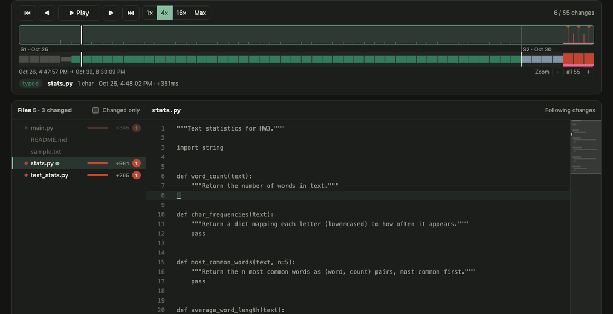
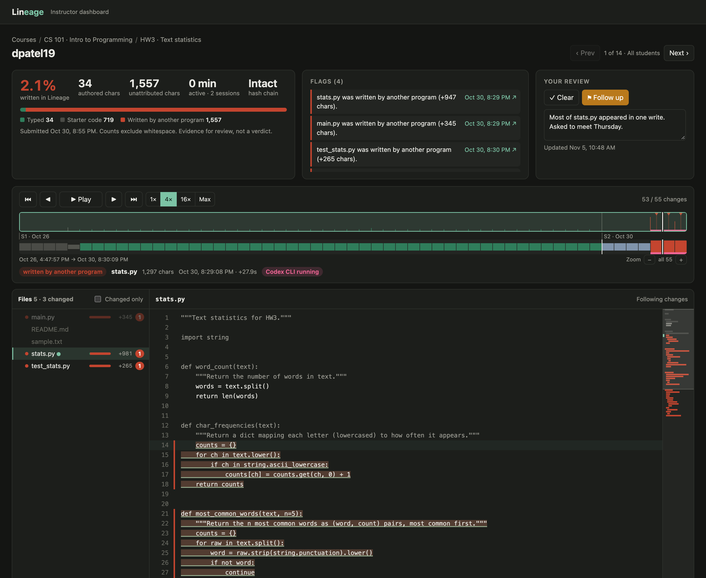
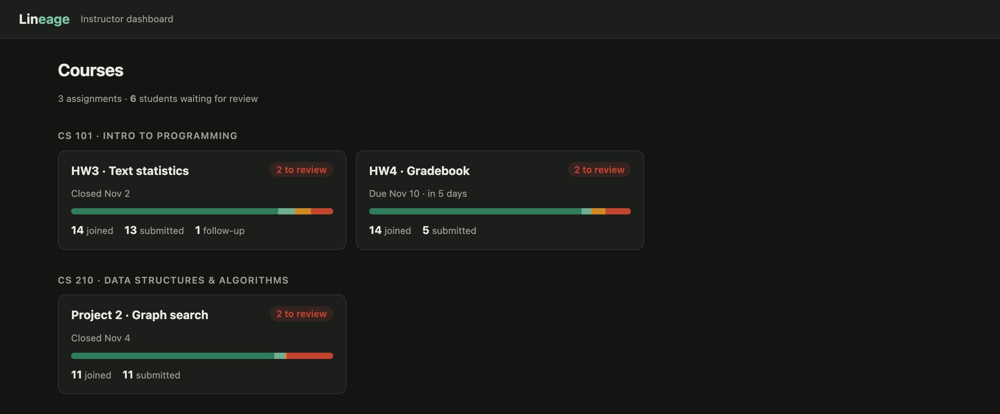
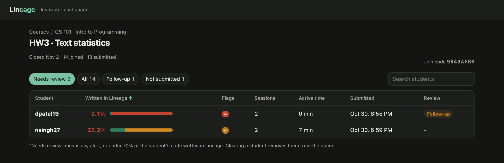
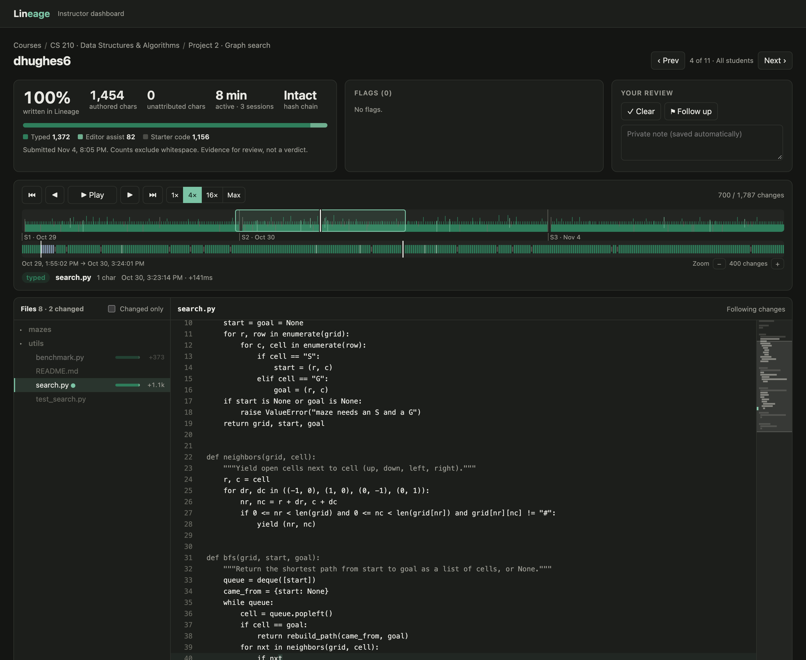
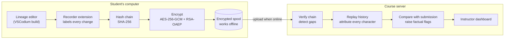

<div align="center">


# Lineage

### Show how the code got written.

**Lineage is a code editor for computer science courses. It records where every line of an assignment came from (typed, pasted, or written by an AI agent), so honest students can prove their work is theirs and instructors can see what didn't come from the student.**

[](LICENSE)
[](https://github.com/VSCodium/vscodium)
[](https://nodejs.org)
[](#roadmap)

[**See it in 30 seconds**](#try-the-demo-in-one-command) · [How it works](#how-it-works) · [What it catches](#what-it-catches-and-what-it-doesnt) · [Privacy](#privacy-by-design)

<br />



<sub>A real replay from the demo: the student types a little (green), then an AI agent started in Lineage's terminal writes three files at once (red).</sub>

</div>

---

## The problem

An AI agent can finish a CS assignment in two minutes. Every existing answer to that has a serious drawback:

| Current approach | Drawback |
|---|---|
| **Plagiarism checkers** (MOSS and similar) | They compare students with each other. Freshly generated AI code matches no one. |
| **AI text detectors** | They guess from the finished code, and they falsely accuse real students. |
| **Webcam proctoring** | It's invasive, students hate it, and it doesn't work for take-home projects. |
| **Banning AI in the syllabus** | Without evidence it can't be enforced, and honest students can't prove anything either. |

All of these look at the **finished code**. Lineage looks at **how the code was written**.

## What Lineage does

<table>
<tr>
<td width="33%" valign="top">

### Records where code came from
Every change to the assignment is labeled at the moment it happens: **typed**, **pasted from inside the editor**, **pasted from outside**, **written to disk by another program**, or **changed while Lineage was closed**.

</td>
<td width="33%" valign="top">

### Private and tamper-evident
Events form a **SHA-256 hash chain** and are **encrypted on the student's machine** for the course server. Students can't read or change their own recording, and deleted batches show up as alerts.

</td>
<td width="33%" valign="top">

### Gives evidence, not verdicts
The server replays the history to rebuild each file character by character, then reports **how much was written in Lineage** along with factual flags. A person decides what it means.

</td>
</tr>
</table>

<div align="center">

<sub>An agent user: 2.1% written in Lineage. The pink band shows when Codex CLI was running in Lineage's terminal, and red marks code written to disk by another program.</sub>
</div>

## Built for instructors

A dashboard designed for how instructors actually work: **courses, then assignments, then a review queue, then the evidence**.

<table>
<tr>
<td width="50%"></td>
<td width="50%"></td>
</tr>
<tr>
<td><b>Courses.</b> See which assignments have students waiting for review.</td>
<td><b>Review queue.</b> Only flagged students by default. Mark each one <i>Clear</i> or <i>Follow up</i> and the queue shrinks.</td>
</tr>
</table>

On each student's page:

- **Two-level timeline.** The top strip summarizes the whole history (thousands of events) and marks every paste and agent write. Drag it to scroll fast, and use the zoomed strip below for single steps.
- **Replay frame by frame** with `←` `→`, or play it back at the student's own pace.
- **File tree for the whole project**, with each file colored by where its code came from. Untouched starter files are dimmed.
- **Code view with a minimap** that shows where in a file the code that wasn't written in Lineage is.
- **Flags link to the exact moment**, and private notes are saved per student.
- **Move through the queue** with `[` `]` without going back to the list.

<div align="center">

<sub>An honest student: 100% written in Lineage across three sessions over six days, with no flags. The same evidence protects students from false accusations.</sub>
</div>

## How it works



1. The instructor puts a `.lineage.json` in the starter repo. Students open the project in Lineage and join with a code.
2. The recorder labels each change by where it came from. For example, agents like Claude Code write files straight to disk, so their code arrives as *written to disk by another program*, never as typing.
3. Events are chained and encrypted before they leave the student's machine. Only the course server can read them.
4. The server replays everything, checks the result against the submission, and shows the evidence to the instructor.

## What it catches, and what it doesn't

Lineage is honest about its limits; that's what makes its evidence hold up.

| Scenario | Result |
|---|---|
| Agent (Claude Code, Codex, Aider, …) edits the project files | ✅ **Caught.** Code shows as *written to disk by another program*. |
| Agent started from Lineage's terminal | ✅ **Caught.** Logged with how long it ran. |
| Agent history folder exists for this project | ✅ **Caught.** Found by exact path, without reading it. |
| Code pasted from ChatGPT, a website or a friend | ✅ **Caught.** Logged as *pasted from outside*, with the exact text. |
| Files changed while Lineage was closed | ✅ **Caught.** Logged as *changed while closed*. |
| Student edits or deletes their recording | ✅ **Caught.** Hash chain breaks, or an alert names the missing events. |
| Student retypes AI output by hand from another screen | ❌ **Not caught, on purpose.** That's transcription. Pair Lineage with a 5-minute "walk me through this" conversation; the replay shows you exactly what to ask about. |

## Privacy by design

Lineage only records facts about **this project, inside this editor**.

- ✅ Edits to project files and where they came from
- ✅ AI agents started from Lineage's own terminal
- ✅ Agent traces for this project, checked by **exact path only**: never listing folders, never reading contents
- ❌ No process monitoring, no screen capture, no camera, no microphone, no OS-level monitoring
- ❌ No typing-rhythm or other behavioral profiling

Recordings are encrypted for the instructor's server, so **students can't read their own replay**, and flags never appear on the student's machine. The student is told what Lineage records, not what it found.

## Try the demo in one command

You need [Node.js 24+](https://nodejs.org). Nothing else to install.

```sh
git clone https://github.com/baileyarzate/Lineage.git
cd Lineage/lineage/server
npm run demo
```

Open the dashboard link it prints. The demo has **2 courses, 3 assignments, 39 students and about 42,000 events**, including honest students, a last-night crammer, a student who pastes from the web, and AI agent users.

### Try recording yourself

```sh
# Terminal 1: server
cd lineage/server
npm run create-assignment -- demo-hw     # prints a join code
npm start                                # prints the dashboard link

# Terminal 2: recorder extension
cd lineage/recorder
npm install && npm run compile
code .                                   # then press F5
```

A window opens on [`lineage/sample-assignment`](lineage/sample-assignment). Join with any student ID and the code, type a solution, then try `echo "x = 1" >> main.py` in a terminal or run an agent there. Run **Lineage: Submit Assignment** and open the dashboard. Full details are in [lineage/README.md](lineage/README.md).

### Set up a real course

```sh
npm run create-course -- cs101 "CS 101 · Intro to Programming"
npm run create-assignment -- cs101-hw3 --course cs101 --title "HW3 · Text statistics" --due 2026-12-01
```

Then add the printed `.lineage.json` to the starter repo.

## Repository layout

| Path | What's there |
|---|---|
| [`lineage/server`](lineage/server) | Course server, review dashboard, replay engine and demo data generator. Node 24 with no dependencies (built-in `node:sqlite`). |
| [`lineage/recorder`](lineage/recorder) | Editor extension that labels changes, notices agents, and handles the hash chain, encryption and offline spool. |
| [`lineage/sample-assignment`](lineage/sample-assignment) | A starter project to try it on. |
| Everything else | The [VSCodium](https://github.com/VSCodium/vscodium) build scripts, rebranded so the desktop app is called **Lineage** (`lineage` command, `com.lineage` bundle ID). |

### Build the desktop app

```sh
SHOULD_BUILD_CLI=no ./dev/build.sh      # skip the Rust CLI if Rust isn't installed
```

See [docs/howto-build.md](docs/howto-build.md) for requirements. The output is `VSCode-darwin-<arch>/Lineage.app` on macOS.

### Tests

```sh
cd lineage/server && npm test
```

## Roadmap

- [x] Change labeling, hash chain, encryption, offline spool
- [x] Server replay, coverage report, submission matching, gap detection
- [x] Instructor dashboard: courses, review queue, timeline, file tree, minimap
- [x] Detecting AI agents without monitoring the computer
- [ ] Bundle the recorder into the Lineage build so it's always on
- [ ] Block AI extensions and built-in chat in the build (extension allowlist)
- [ ] Check the graded git commit against the recording
- [ ] HTTPS, instructor accounts, hosted deployment
- [ ] Integration with GitHub Classroom and LMS platforms

## Credits

Lineage's desktop app is built on [VSCodium](https://github.com/VSCodium/vscodium), which builds Microsoft's open-source [`vscode`](https://github.com/microsoft/vscode) without its telemetry. VSCodium's original README is kept in [docs/vscodium-README.md](docs/vscodium-README.md). Lineage isn't affiliated with Microsoft or VSCodium.

Released under the [MIT License](LICENSE).
